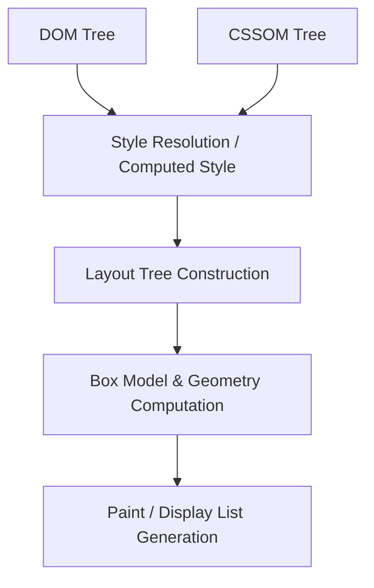

When a browser receives a 200 OK HTTP response with an HTML document stream, most developers think of the transition to pixels as an instantaneous paint. In reality, the modern browser engine executes one of the most sophisticated concurrent processing pipelines in computing. Between the first byte arriving over TCP and physical photons radiating from your display, the browser must parse bytes into tokens, construct recursive graph models, compute cascaded styles, calculate floating-point geometry, generate display lists, and coordinate tile-based rasterization across multiple GPU threads.

Understanding this **Critical Rendering Path (CRP)** is not just academic trivia—it is the engineering baseline required to eliminate layout shifts, optimize Largest Contentful Paint (LCP), and avoid frame drops during 120Hz interactions.

---

## 1. The Multi-Process Browser Topology

Before examining the pipeline itself, consider the underlying hardware isolation. In Chromium-based engines (Blink + V8), rendering does not happen in a single monolithic thread:

1. **The Browser Process**: Manages tabs, window chrome, filesystem I/O, and network requests.
2. **The Renderer Process**: Isolated in a sandbox per origin (or per tab). Hosts the **Main Thread**, the **Compositor Thread**, the **Raster Thread Pool**, and service worker threads.
3. **The GPU Process**: Handles draw calls, OpenGL/Vulkan/Metal API bindings, and final frame submission to the operating system display compositor.

```
+-------------------------------------------------------------------+
| Browser Process (Network, Cookies, IPC Broker)                   |
+-------------------------------------------------------------------+
                                  | IPC (Inter-Process Communication)
                                  v
+-------------------------------------------------------------------+
| Renderer Process (Sandboxed)                                     |
|                                                                   |
|  [Main Thread]                                                    |
|  HTML/CSS Parse -> DOM/CSSOM -> Style -> Layout -> Pre-Paint      |
|                                  | Commit                         |
|                                  v                                |
|  [Compositor Thread]                                              |
|  Scroll/Gesture Handling -> Layer Tree -> Tiling -> DrawQuads     |
|                                  | Raster Tasks                   |
|                                  v                                |
|  [Raster Threads (Pool)]                                          |
|  Execute Skia/PaintOps -> Write pixels to GPU Shared Memory       |
+-------------------------------------------------------------------+
                                  | Surface Sync
                                  v
+-------------------------------------------------------------------+
| GPU Process: Composites Surfaces -> Framebuffer -> Hardware Display|
+-------------------------------------------------------------------+
```

---

## 2. From Network Bytes to the DOM and CSSOM Trees

When network packets arrive via TLS sockets, the renderer receives a sequence of raw bytes. The transformation into the Document Object Model (DOM) follows four deterministic phases:

### Bytes → Characters → Tokens → Nodes → DOM

1. **Decoding**: Converts raw bytes (`48 65 6c 6c 6f`) into character strings based on the document encoding (typically UTF-8).
2. **Tokenization**: An algorithm defined strictly by the WHATWG HTML5 specification. As characters stream in, the tokenizer emits tokens: `StartTag: <html>`, `StartTag: <head>`, `Character`, `EndTag: </head>`.
3. **Tree Construction**: While tokens are emitted, the tree construction stage organizes elements into parent-child hierarchies. If an author writes malformed HTML (e.g., nesting a block element inside a paragraph), the HTML5 parsing algorithm executes error recovery without aborting.

```html
<!-- Example Document Stream -->
<!DOCTYPE html>
<html>
  <head>
    <link rel="stylesheet" href="styles.css" />
  </head>
  <body>
    <main class="container">
      <h1>Distributed Systems</h1>
    </main>
  </body>
</html>
```

### The CSS Object Model (CSSOM)

Parallel to HTML tokenization, the engine fetches and parses linked stylesheets. Unlike HTML, CSS parsing is **strictly context-free**. The parser constructs the CSSOM where rules cascade from root to leaf:

```
                  [body (font-size: 16px)]
                             |
                [main.container (display: flex)]
                             |
             [h1 (font-size: 2em; color: #0ea5e9)]
```

> **Performance Bottleneck (CSS is Render-Blocking)**: The browser cannot construct the visual layout tree until the CSSOM is completely assembled. Any unoptimized `@import` or massive external stylesheet blocks initial rendering completely.

---

## 3. Style Resolution & The Layout Tree

With the DOM and CSSOM ready, the engine constructs the **Layout Tree** (historically called the Render Tree). 

The Layout Tree contains only **visible nodes**. Nodes that carry `display: none` or `<head>` elements are discarded. Conversely, pseudo-elements like `::before` and `::after` exist in the Layout Tree even though they have no DOM counterpart.



### Geometry and Reflow

Once the Layout Tree nodes are established, the engine calculates exact geometry:
- Coordinates (`x`, `y`) relative to viewport origin
- Width and height bounding boxes (`px`, `em`, `rem`, `%` resolved to device pixels)
- Margin collapse and flexbox/grid layout constraints

When an author script reads a geometric property after modifying the DOM:

```javascript
// FORCED SYNCHRONOUS REFLOW (Anti-Pattern)
element.classList.add('expanded');
const currentHeight = element.offsetHeight; // Forces immediate layout computation!
```

This triggers **Forced Synchronous Layout (Layout Thrashing)**, starving the CPU thread and dropping frames below 60fps.

---

## 4. Painting, Tiling, and GPU Rasterization

Once box geometry is finalized, the engine must convert vector geometric commands into bitmap pixel arrays. This process has evolved significantly over the last decade.

### 1. Generating Display Lists
The Main Thread traverses the layout tree and creates a serial record of paint operations known as a **Display List**:
- `drawRect(0, 0, 400, 200, paintObj)`
- `drawText("Distributed Systems", x, y, fontObj)`

### 2. Layer Promotion & Compositing
Elements with properties like `transform: translateZ(0)`, `will-change: transform`, or `<video>` are promoted to separate **Compositor Layers**.

### 3. Tiling and Raster Threads
Instead of rasterizing an entire 5,000-pixel-high document at once, the Compositor Thread divides each layer into **Tiles** (typically 256×256 or 512×512 pixels). Only tiles currently visible within (or directly adjacent to) the viewport are prioritized for rasterization by the worker thread pool using the Skia graphics library.

```
Viewport:
+------------------------+
| Visible Tile (P1)      | -> Dispatched to GPU Rasterizer
+------------------------+
| Visible Tile (P1)      | -> Dispatched to GPU Rasterizer
+------------------------+
| Pre-fetch Tile (P2)    | -> Queued
+------------------------+
| Offscreen Tile (P3)    | -> Idle / Unrasterized
+------------------------+
```

---

## 5. Modern Performance Profiling & Diagnostic Checklist

To diagnose bottlenecks in the rendering path, open Chrome DevTools, navigate to the **Performance Panel**, and record a 5-second trace of page interactions.

| Pipeline Phase | Primary DevTools Event | Optimization Target |
|---|---|---|
| **Parse HTML** | `Parse HTML` | Minimize HTML payload, stream responses via HTTP chunking |
| **Parse CSS** | `Parse Stylesheet` | Inline critical CSS, remove unused selector depth |
| **Layout** | `Layout` / `Update Layout Tree` | Avoid layout thrashing; batch DOM read/writes |
| **Paint** | `Paint` | Reduce complex CSS blur filters and non-promoted transforms |
| **Composite** | `Composite Layers` | Animate strictly `transform` and `opacity` properties |

For enterprise observability across client interactions, modern teams rely on specialized monitoring platforms like [Datadog](https://www.datadoghq.com/?ref=signalinsight_browser-rendering) ★ and [Sentry Performance Monitoring](https://sentry.io/?ref=signalinsight_browser-rendering) ★ to trace real-user Core Web Vitals (INP, LCP, CLS) across global network edges.

---

## Summary Takeaways

1. **Rendering is an asynchronous, multi-threaded assembly line**: The Main Thread executes parsing, JavaScript, and layout; the Compositor Thread orchestrates tiles and scroll physics; GPU threads render pixels.
2. **CSS blocks rendering; JS blocks parsing**: Keep critical CSS under 14KB to fit into initial TCP congestion window (CWND) packets.
3. **Animate on the compositor**: Restrict CSS transitions to `transform` and `opacity` so that animations can bypass layout and paint entirely on the GPU.

